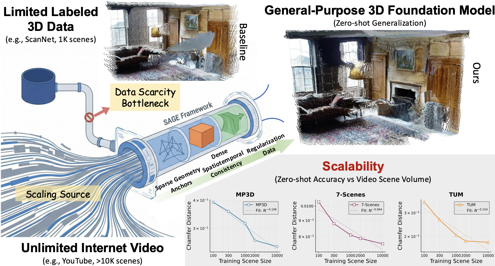
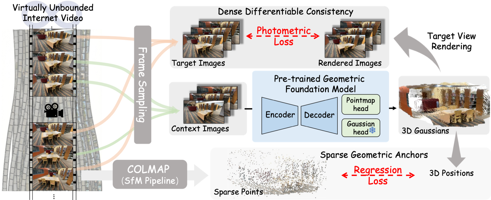

<div align="center">

# SAGE: Scalable Adaptation of 3D Geometric Foundation Models via Weak Supervision from Internet Video

**NeurIPS 2026**

Zihui Gao<sup>1,2</sup>, Ke Liu<sup>3</sup>, Donny Y. Chen<sup>4</sup>, Duochao Shi<sup>2</sup>, Guosheng Lin<sup>1</sup>, Jia-Wang Bian<sup>1†</sup>, Hao Chen<sup>2†</sup>, Chunhua Shen<sup>2</sup>

<sup>1</sup>Nanyang Technological University, Singapore &nbsp;&nbsp;
<sup>2</sup>Zhejiang University, State Key Lab of CAD & CG <br>
<sup>3</sup>School of Software Technology, Zhejiang University, Ningbo, China &nbsp;&nbsp;
<sup>4</sup>Monash University

<sup>†</sup>Corresponding authors

[](https://openreview.net/forum?id=pcEDgJBGuB)
[](https://openreview.net/forum?id=pcEDgJBGuB)



</div>

## News

- **[2026-10]** Repository created. Code and checkpoints are coming soon.
- **[2026-09]** SAGE is accepted to **NeurIPS 2026**.

## Overview

Geometric foundation models such as DUSt3R, MV-DUSt3R, and VGGT are bottlenecked by the scarcity of large-scale 3D annotations. **SAGE** adapts a *pretrained* geometric foundation model with abundant **static-scene Internet video**, without any ground-truth 3D annotations for the video data.

From each video, SAGE builds training samples and supervision in three steps:

1. **Informative trajectory sampling.** Stochastically perturbed temporal sampling picks frames that balance viewpoint diversity against geometric overlap.
2. **Sparse geometric anchors.** Sparse SfM points and cameras from a one-time COLMAP pass anchor the predicted pointmaps to a globally consistent structure.
3. **Dense differentiable consistency.** A *frozen* 3D Gaussian Splatting head renders context and target views. The photometric gradients flow back into the backbone's geometry, not into the renderer.

A small fraction (~3%) of supervised replay data from the original pretraining distribution prevents catastrophic forgetting.

<div align="center">

</div>

## Results

8-view reconstruction at 224×224. ScanNet is in-distribution; 7Scenes, TUM-RGBD, and Matterport3D are zero-shot. MP3D DAc is reported at threshold 0.5; the other datasets use 0.2.

<div align="center">
<table>
  <tr><th><sub>Method</sub></th><th><sub>ScanNet<br>DAc↑ / CD↓</sub></th><th><sub>7Scenes<br>DAc↑ / CD↓</sub></th><th><sub>TUM-RGBD<br>DAc↑ / CD↓</sub></th><th><sub>MP3D<br>DAc↑ / CD↓</sub></th></tr>
  <tr><td><sub>MV-DUSt3R</sub></td><td><sub>88.2 / 1.79</sub></td><td><sub>89.6 / 0.95</sub></td><td><sub>87.5 / 2.60</sub></td><td><sub>30.3 / 43.2</sub></td></tr>
  <tr><td><sub><b>MV-DUSt3R + SAGE</b></sub></td><td><sub><b>91.2 / 1.69</b></sub></td><td><sub><b>98.0 / 0.76</b></sub></td><td><sub><b>93.1 / 1.85</b></sub></td><td><sub><b>48.0 / 24.9</b></sub></td></tr>
  <tr><td><sub>VGGT</sub></td><td><sub>87.0 / 3.30</sub></td><td><sub>88.5 / 1.13</sub></td><td><sub>80.4 / 4.24</sub></td><td><sub>53.1 / 20.7</sub></td></tr>
  <tr><td><sub><b>VGGT + SAGE</b></sub></td><td><sub><b>89.5 / 2.01</b></sub></td><td><sub><b>92.0 / 0.79</b></sub></td><td><sub><b>84.3 / 2.84</b></sub></td><td><sub><b>55.4 / 18.3</b></sub></td></tr>
</table>
</div>

On MV-DUSt3R, SAGE reduces Chamfer Distance by **20–42%** on the three unseen benchmarks. Zero-shot accuracy improves approximately log-linearly as the adaptation set grows from 100 to 10K video scenes. Adaptation takes under two days on 4× RTX 4090 GPUs.

## Installation

Coming soon.

## Data Preparation

Coming soon. SAGE adapts on static-scene clips from [RealEstate10K](https://google.github.io/realestate10k/) and [DL3DV](https://dl3dv-10k.github.io/DL3DV-10K/). Each clip is processed with [COLMAP](https://colmap.github.io/) to obtain sparse 3D points and camera parameters. No dense MVS is required.

## Training and Evaluation

Coming soon.

## Citation

If you find this work useful, please cite:

```bibtex
@inproceedings{gao2026sage,
  title     = {Scalable Adaptation of 3D Geometric Foundation Models via Weak Supervision from Internet Video},
  author    = {Gao, Zihui and Liu, Ke and Chen, Donny Y. and Shi, Duochao and Lin, Guosheng and Bian, Jia-Wang and Chen, Hao and Shen, Chunhua},
  booktitle = {Advances in Neural Information Processing Systems (NeurIPS)},
  year      = {2026}
}
```

## Acknowledgements

This project builds on [MV-DUSt3R](https://github.com/facebookresearch/mvdust3r), [VGGT](https://github.com/facebookresearch/vggt), [DUSt3R](https://github.com/naver/dust3r), and [COLMAP](https://github.com/colmap/colmap). We thank the authors for releasing their code and the creators of RealEstate10K and DL3DV for their datasets.

## Contact

For questions, please open an issue or contact the corresponding authors: Hao Chen (haochen.cad@zju.edu.cn) and Jia-Wang Bian (jiawang.bian@ntu.edu.sg).
